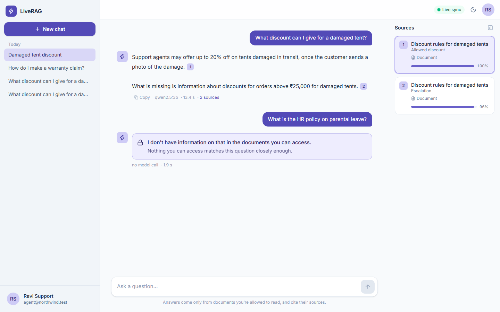
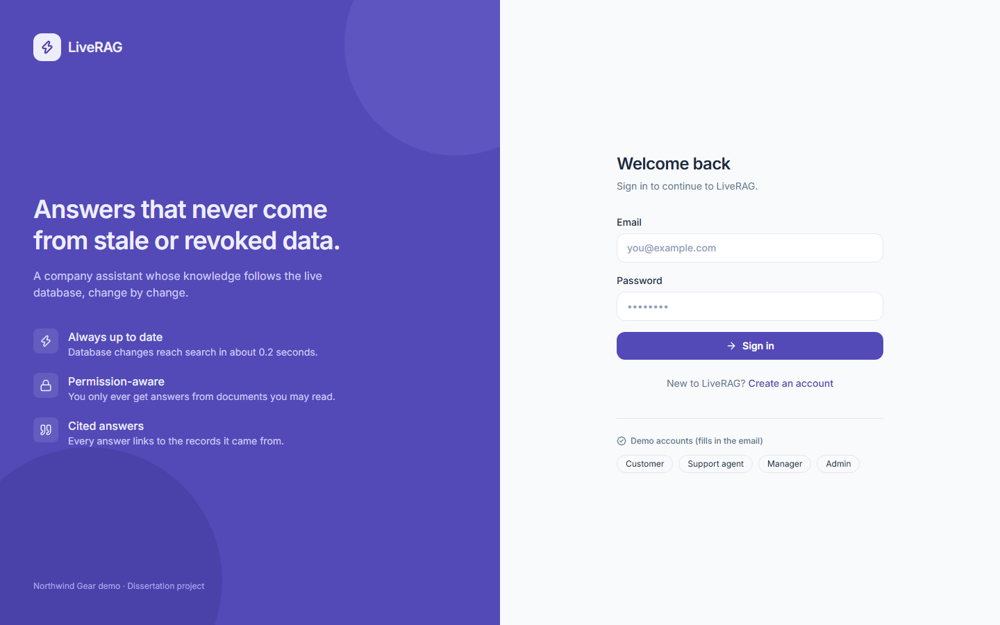
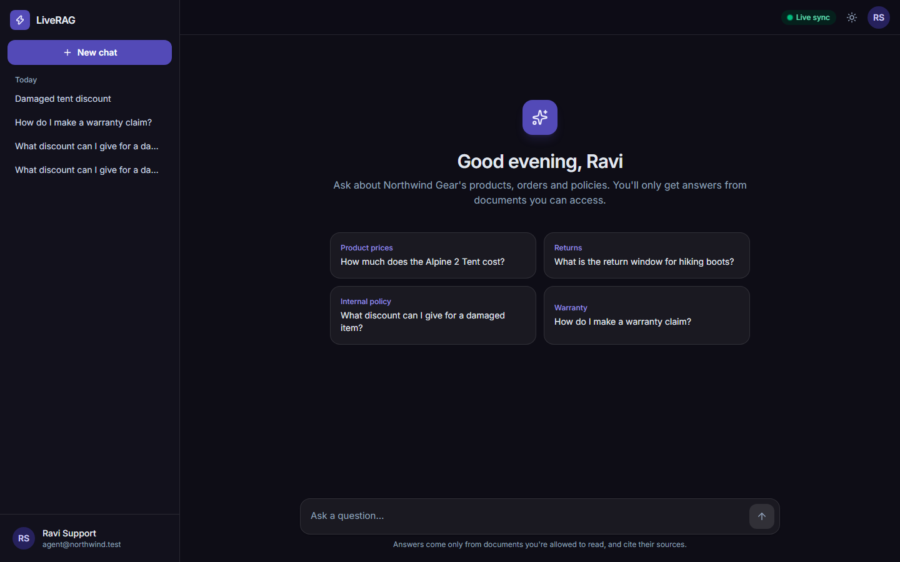
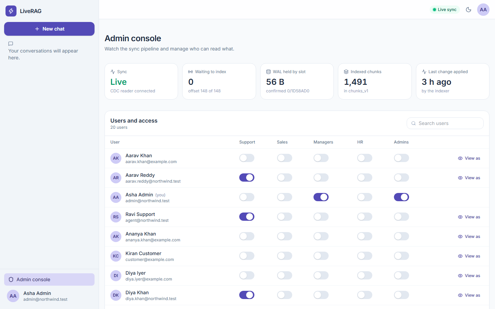
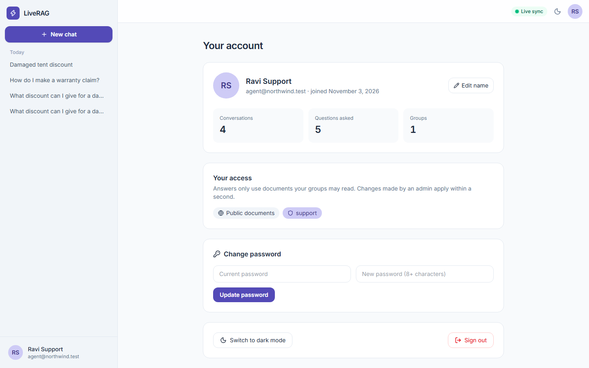
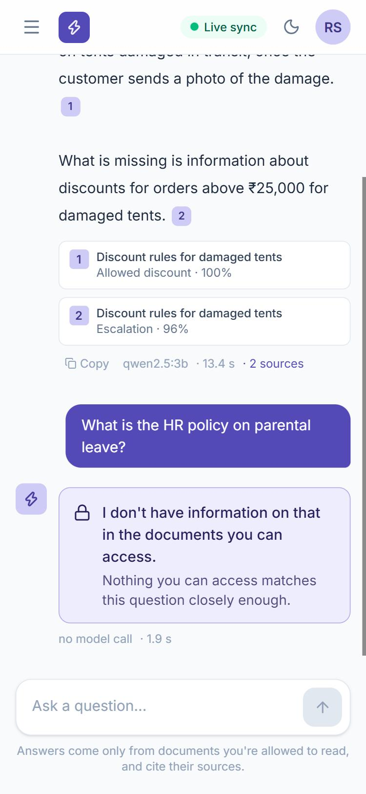

# LiveRAG

**A permission-aware RAG assistant whose search index stays in sync with a live PostgreSQL
database through log-based change data capture (CDC), with exactly-once effects.**

Every insert, update, delete and permission change is read from Postgres's write-ahead log,
sent through Redpanda and applied to a pgvector index in about **0.2 seconds**. Revoked access
disappears from search just as fast, and the index stays correct even when the pipeline is
killed mid-transaction.

> Dissertation-2 project. All numbers below come from the scripts in `evals/` and the JSON
> files in `evals/results/`.



## Results

### CDC vs the usual alternatives (same 30 changes for each method)

| Method | Changes visible | Missed | Staleness p50 | Staleness p95 | Leak window p95 | Chunks written |
|---|---|---|---|---|---|---|
| **LiveRAG (log-based CDC)** | **30/30** | **0** | **0.20 s** | **0.26 s** | **0.26 s** | **20** |
| Polling `updated_at` every 5 s | 12/30 | 18 | 2.57 s | 3.81 s | never (12 revocations not applied) | 77 |
| Batch rebuild every 60 s | 30/30 | 0 | 43.2 s | 64.7 s | 64.7 s | 2,947 |

Polling missed **every** hard delete, ACL revoke and group removal: those leave no `updated_at`
to find. Batch is correct but stale for up to a full interval (with a nightly job: hours).
Source: `evals/results/baselines.json`, `uv run python -m evals.baselines`.

### Correctness under failure
- **Chaos test:** 80 random changes with 6 hard kills of the CDC reader and indexer: the index
  ends **byte-for-byte equal** to the source (md5 fingerprints); 4 real duplicate deliveries were
  removed by the LSN guard; freshness p50 0.22 s. (`evals/results/chaos.json`)
- **Snapshot handoff:** under ~50 writes/s, starting CDC the naive way (index first, slot second)
  left 46–49 of 500 products wrong; the exported-snapshot handoff left **0**.
- **Streamed index = fresh batch rebuild** after updates, duplicates, a crash and a full reload.

### Retrieval and answers (44-question golden set, 0 permission leaks)

| Mode | hit@1 | hit@5 | MRR |
|---|---|---|---|
| Hybrid + cross-encoder rerank | 0.90 | 0.97 | 0.93 |
| Hybrid (vector + full-text, RRF) | 0.90 | 0.93 | 0.91 |
| Vector only | 0.86 | 0.90 | 0.88 |
| Keyword only | 0.83 | 0.93 | 0.88 |

End to end (local `qwen2.5:3b`): 100 % of forbidden/unanswerable questions refused, 0 answer
leaks, 92 % of given answers contain the correct fact, 72 % fully correct (fact + citation).

## The web app

A complete chat application in a lavender theme, with light and dark mode and a phone layout.

| | |
|---|---|
|  |  |
| **Sign in or create an account.** New accounts start with public documents only. | **Start a chat** from suggestions, in light or dark mode. |
|  |  |
| **Admin console:** live pipeline health and one toggle per user and group. A toggle writes to the source database; CDC carries it to search in about a second. | **Your account:** profile, your access, statistics, password, theme. |

- **Cited, streamed answers:** numbered citation chips; a sources panel shows each document,
  its section and how closely it matched (under the answer on smaller screens).
- **Honest refusals:** questions about documents you may not read get a lock card, and the
  language model never sees those documents.
- **Saved conversations:** your chat history in the sidebar (rename, delete); nobody else can
  open it.
- **Live sync status:** a pill in the top bar shows whether the CDC pipeline is running.
- **View as:** admins can ask exactly as any other user would, to check what they can see.

<p align="center"></p>

## Architecture

```
 Source DB (Postgres 16, wal_level=logical)
   │  replication slot (pgoutput)
   ▼
 CDC reader ──► Redpanda (1 partition, one message per transaction)
                   │
                   ▼
              Streaming indexer ──► Index DB (Postgres 16 + pgvector + full-text)
                                       ▲
 React web app ──► FastAPI ─────────────┘  hybrid search → rerank → LLM with validated citations
```

- **Reader** confirms a WAL position to Postgres only after Redpanda has acknowledged it.
- **Indexer** applies each source transaction in **one** index transaction together with an LSN
  guard and its Kafka offset, so duplicates are harmless and crashes lose nothing.
- **Permissions** are filtered **inside** the search SQL; group membership is read on every
  request and kept in sync by the same CDC pipeline.
- **Bootstrap** creates the slot with an exported snapshot, so batch and stream meet at one LSN.
- **Accounts and access changes** made in the app write to the source database (the app plays
  the company's own system); the search index still changes **only** through CDC.

### API (FastAPI, docs at `/docs`)

| Area | Endpoints |
|---|---|
| Auth and account | `POST /api/v1/auth/signup`, `POST /api/v1/auth/login`, `GET/PATCH /api/v1/me`, `POST /api/v1/me/password` |
| Chat | `POST /api/v1/chat/stream` (SSE, saved to a conversation), `POST /api/v1/chat` (JSON, used by evals), `POST /api/v1/search` |
| Conversations | `GET /api/v1/conversations`, `GET/PATCH/DELETE /api/v1/conversations/{id}` |
| Sync status | `GET /api/v1/status` |
| Admin | `GET /api/v1/admin/pipeline`, `GET /api/v1/admin/users`, `GET /api/v1/admin/groups`, `PUT/DELETE /api/v1/admin/users/{id}/groups/{group}` |

## Tech stack
Python 3.12 · uv · PostgreSQL 16 · pgvector (HNSW) · Redpanda · confluent-kafka · psycopg 3 /
psycopg2 (replication) · FastAPI · Alembic · sentence-transformers (bge-small-en-v1.5,
bge-reranker-base) · Ollama (qwen2.5:3b) · JWT + Argon2 · React 19 + Vite + Tailwind CSS 4 +
React Router + lucide icons · Docker Compose · GitHub Actions

## Run it locally

Requirements: Docker Desktop, Python 3.12 with [uv](https://docs.astral.sh/uv/), Node 22, Ollama.

```bash
cp .env.example .env          # then fill in passwords and a JWT_SECRET of 32+ characters
docker compose up -d          # source-db :5433, index-db :5434, redpanda :19092
ollama pull qwen2.5:3b

cd services/simulator && uv run python -m simulator.seed            # demo data
cd ../api            && uv run alembic upgrade head                 # index schema + chat history
cd ../indexer        && uv run python -m indexer.bootstrap          # index + slot, no gap
```

Then, each in its own terminal:

```bash
cd services/cdc      && uv run python -m cdc.reader                 # WAL -> Redpanda
cd services/indexer  && uv run python -m indexer.stream             # Redpanda -> index
cd services/api      && uv run uvicorn app.main:app                 # API on :8000
cd apps/web          && npm install && npm run dev                  # UI on :5173
```

Open http://127.0.0.1:5173 and **create your own account**, or use a demo account
(`customer@example.com`, `agent@northwind.test`, `manager@northwind.test`,
`admin@northwind.test`; password = `DEMO_USER_PASSWORD`).

**Try the live access demo:** as your new account, ask *"What discount can I give for a damaged
item?"*: refused. Sign in as the admin, open the **Admin console** and switch on **Support** for
your account. Ask again: answered with cited sources, about a second later and without any
re-indexing.

## Evaluations

```bash
cd evals
uv run python -m evals.retrieval     # retrieval quality, abstention, leak check
uv run python -m evals.answers       # end-to-end answers (API + Ollama running)
uv run python -m evals.chaos         # random changes + hard kills, fingerprint check
uv run python -m evals.baselines     # CDC vs polling vs batch
```

## Repository layout

```
apps/web/              React + Vite app: sign-in/up, chat, sources, account, admin console
services/api/          FastAPI (auth, accounts, chat, conversations, admin) + Alembic migrations
services/cdc/          pgoutput decoder and CDC reader -> Redpanda
services/indexer/      chunking, batch, bootstrap, streaming indexer, polling baseline
services/simulator/    deterministic Northwind Gear demo data
packages/liverag-core/ shared config, embedder, reranker, retrieval SQL
evals/                 golden set, evaluation scripts, results
infra/                 Postgres init scripts, health check
assets/screenshots/    screenshots used in this README
```

## Limitations
Small synthetic dataset and golden set (44 questions); intervals in the baseline experiment are
scaled down (60 s instead of nightly); a single Redpanda partition (global order over
throughput); schema changes (DDL) are not handled automatically; answer quality reflects a
3-billion-parameter local model.